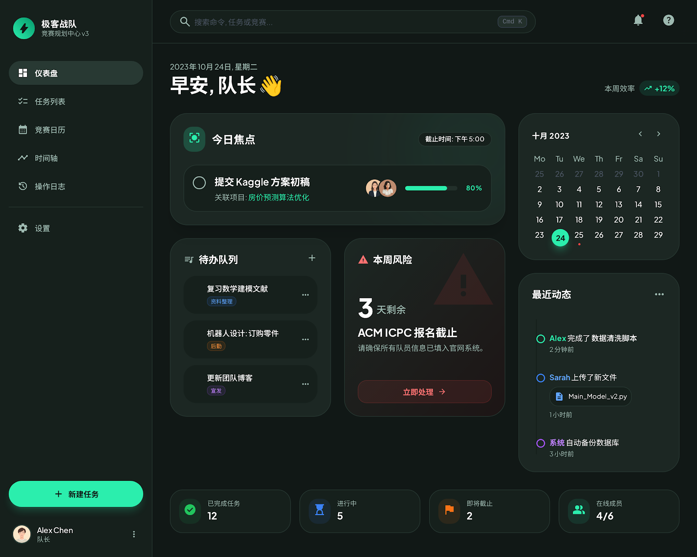
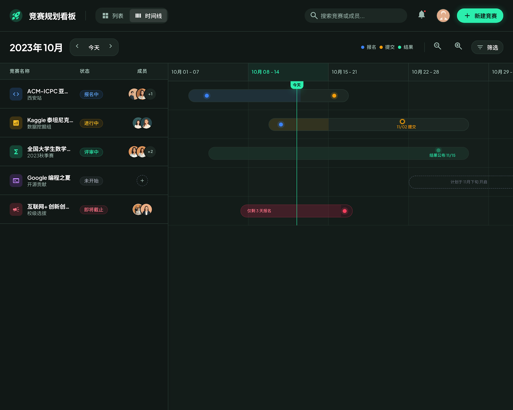
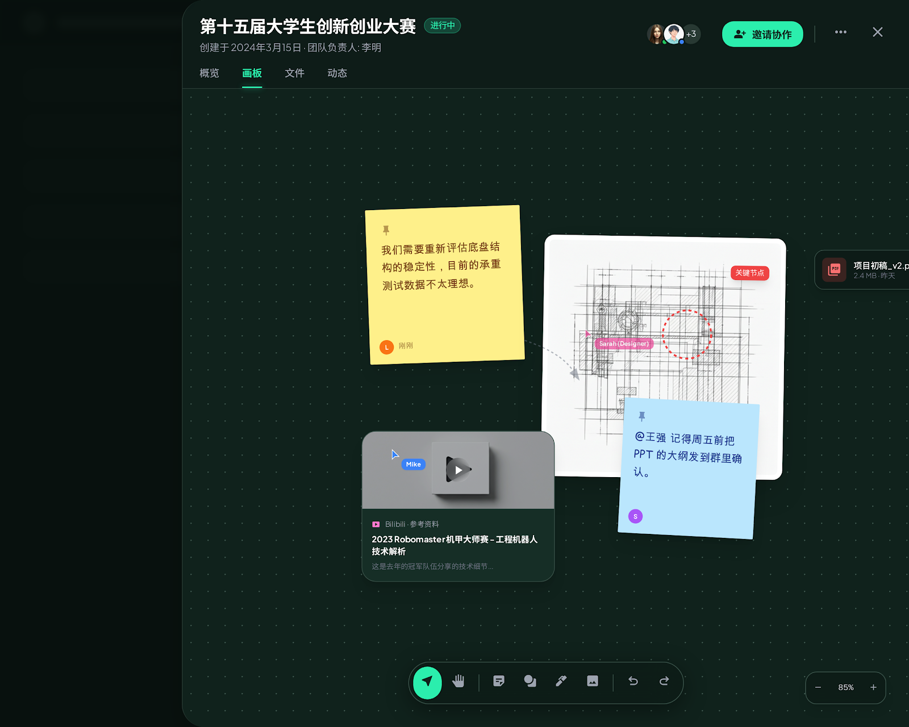
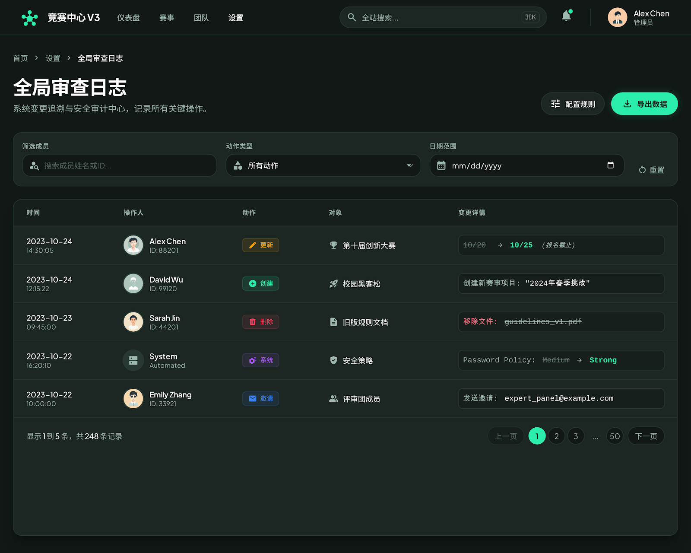
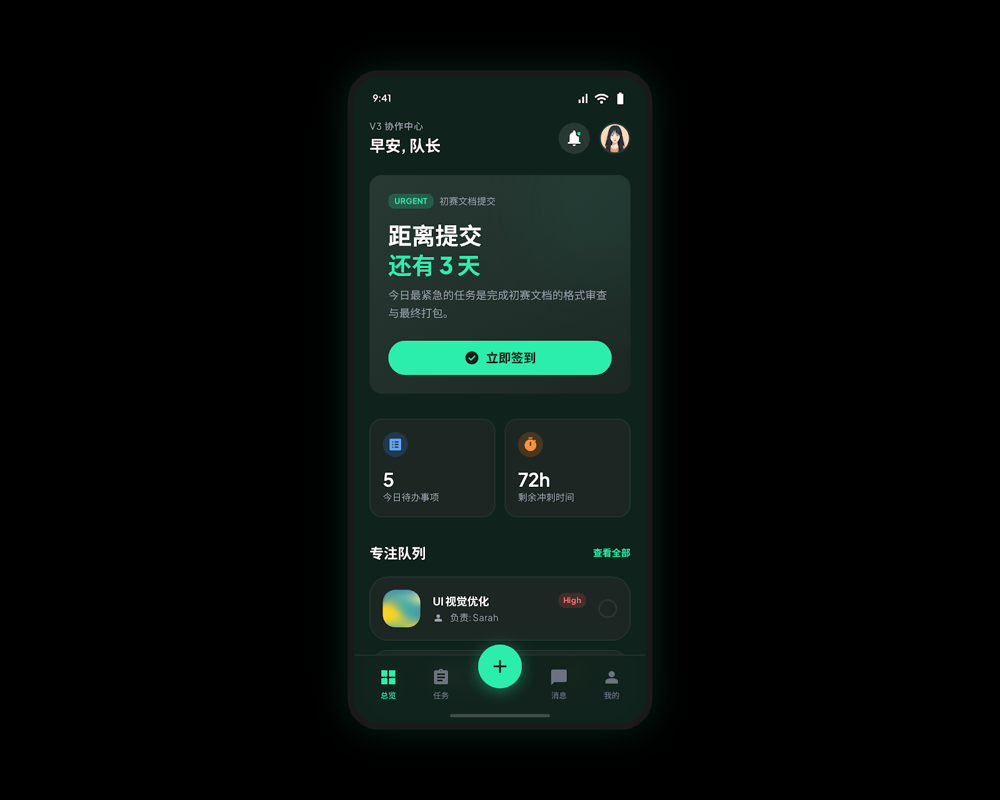

# 🚀 竞赛规划看板 (Competition Mission Control)

<p align="center">
  <b>A Serverless Competition Planning &amp; Milestone Dashboard</b><br>
  基于 Vite + React + Cloudflare Pages Functions + Cloudflare D1 的无服务器学科竞赛与项目里程碑中控面板
</p>

<p align="center">
  
  
  
  
  
  
  
</p>

---

## 🖥️ 核心控制台全景 (Dashboard Overview)

<p align="center">
  
</p>

---

## 🌟 核心特性与多视图矩阵 (Interface Matrix · v3 统一分辨率 1600x1280)

| 📅 议程流与时间线视图 (Timeline & Agenda) | 📝 战术规划白板与头脑风暴 (Whiteboard) |
| :---: | :---: |
|  |  |
| **紧迫度动态聚合**：按 Overdue / Today / This Week / Later 自动归集关键节点，支持日历/时间流双模一键切换。 | **团队协作画板**：围绕重点竞赛头脑风暴、破题思路梳理与技术路线白板草图绘制。 |

| 📜 变更审计日志与历史回溯 (Audit Log) | 📱 移动端自适应响应 (Mobile Dashboard) |
| :---: | :---: |
|  |  |
| **细粒度版本审计**：记录团队成员每次对赛题状态、截止日期、交付物变更的时间戳与操作人流水。 | **随时随地把控进度**：手机与平板端流式响应折叠，关键倒计时预警一眼即达。 |

---

## 📖 项目简介 (Overview)

**竞赛规划看板 (Competition Mission Control)** 专为多线程学术竞赛备赛团队、科研项目组打造的里程碑与日程规划中枢。

传统表格管理容易漏交材料、错过报名窗口或出现多端同步延迟。本项目利用 **Cloudflare 全球边缘网络（Pages + Functions + D1 分布式 SQLite）** 构建了极低延迟、零服务器运维成本的看板。系统支持日程事件流与月/周日历双重视图，并内嵌大模型 Copilot 提供竞赛检索与行动卡片建议。

---

## 🏛️ 系统架构 (Architecture)


---

## 📦 项目代码组织 (Directory Layout)

```text
competition-mission-control/
├── db/                     # D1 数据库定义与种子 SQL
│   ├── schema.sql          # 竞赛里程碑与队伍表结构
│   └── seed_competitions.sql
├── functions/              # Cloudflare Pages Functions (API 路由)
│   └── api/                # /api/competitions CRUD 与 AI 对话端点
├── src/                    # 前端源码
│   ├── ui/v3/              # v3 核心页面与组件 (Dashboard, Timeline, Whiteboard, Audit)
│   ├── lib/                # 离线缓存、D1 API 客户端与时间工具
│   └── domain/             # 竞赛事件流、日程计算与审计模型
├── prototype/v3/           # v3 高清统一实机截图 (1600x1280 统一分辨率)
└── wrangler.toml           # Cloudflare 绑定配置
```

---

## 🚀 快速开始 (Quickstart)

### 1. 安装依赖

```bash
git clone https://github.com/Evan-Joseph/competition-mission-control.git
cd competition-mission-control
npm install
```

### 2. 本地数据库初始化

利用 Cloudflare 官方 CLI `wrangler` 初始化本地 D1 数据库：

```bash
# 初始化表结构
npx wrangler d1 execute competitions-db --local --file=db/schema.sql

# 导入初始种子数据
npx wrangler d1 execute competitions-db --local --file=db/seed_competitions.sql
```

### 3. 本地边缘联调与构建

```bash
npm run build
npx wrangler pages dev dist --d1 DB=competitions-db --local
```

打开本地端口（通常为 `http://localhost:8788`），即可测试完整前后端与边缘数据库联动。

---

## ☁️ 部署到 Cloudflare Pages (Deploy to Cloudflare)

1. 在 [Cloudflare Dashboard](https://dash.cloudflare.com/) 中新建 D1 数据库：
   ```bash
   npx wrangler d1 create competitions-db
   ```
2. 绑定至 Cloudflare Pages 项目：
   - **Build Command**: `npm run build`
   - **Build output directory**: `dist`
   - **Functions directory**: `functions`
   - **D1 Database Binding**: 变量名设为 `DB`，绑定至 `competitions-db`。
3. 配置环境变量（可选 AI 特性）：
   - `GLM_API_KEY`: 智谱清言 API Key
   - `GLM_MODEL`: `glm-4.7-flash` (或兼容模型)

---

## 📄 开源许可证 (License)

本项目采用 [MIT License](LICENSE) 开源。
