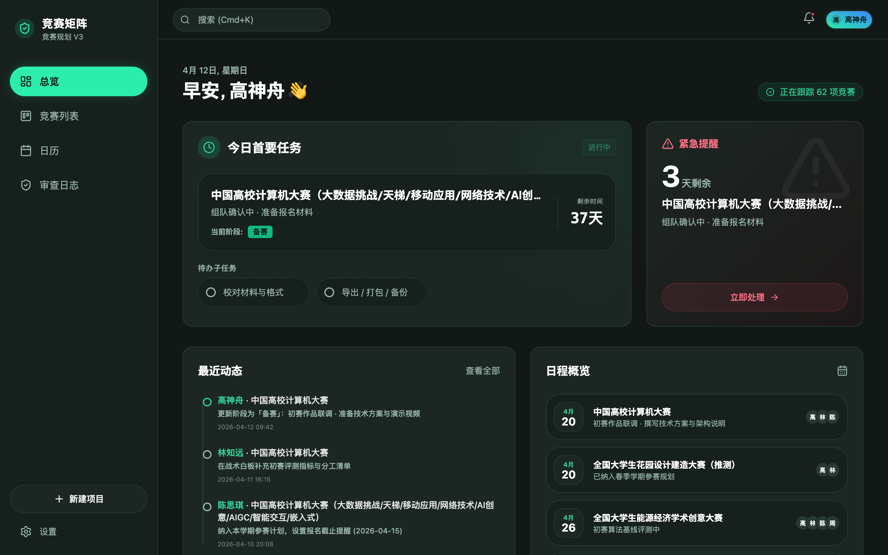
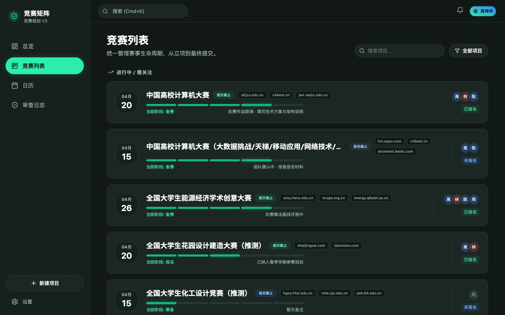
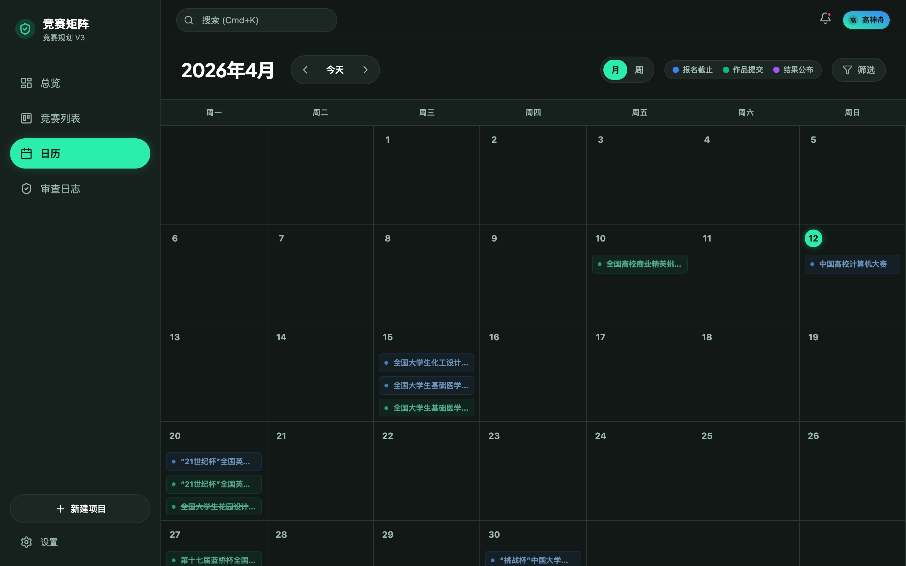
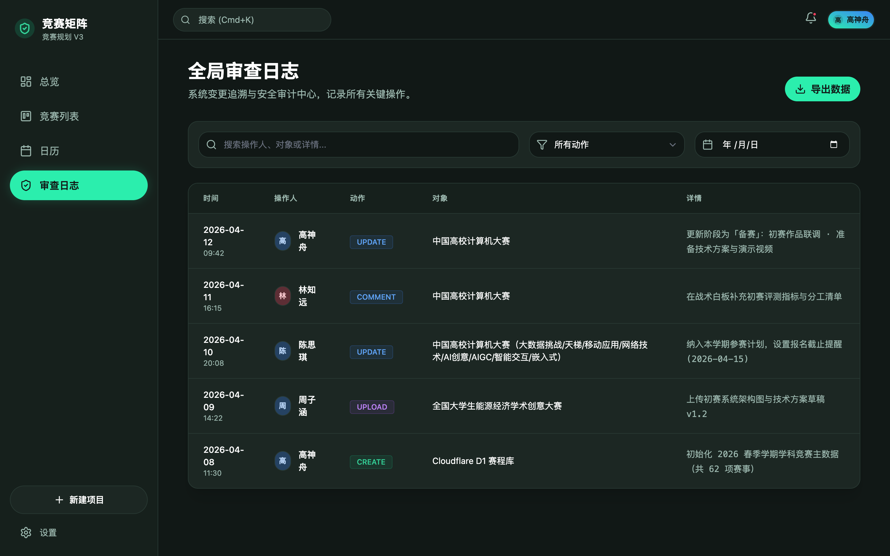
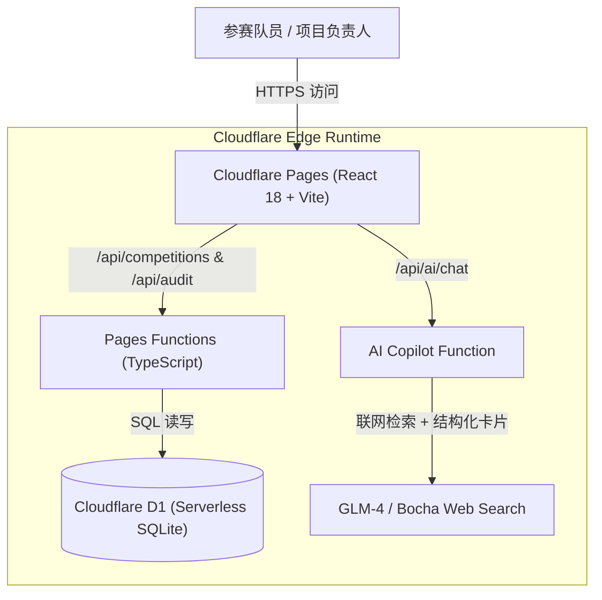

# Competition Mission Control (竞赛矩阵 V3)

<p align="center">
  <b>Serverless Competition Planning, Lifecycle Tracking & Milestone Dashboard</b><br>
  基于 Vite + React + Cloudflare Pages Functions + Cloudflare D1 的无服务器学科竞赛与项目里程碑管理看板
</p>

<p align="center">
  
  
  
  
  
  
  
</p>

---

## 界面总览

<p align="center">
  
</p>

| 赛事列表与阶段追踪 (`/tasks`) | 月度赛程日历 (`/calendar`) |
| :---: | :---: |
|  |  |
| 按生命周期阶段（立项 / 筹备 / 报名 / 备赛 / 提交）与截止日期归集赛事，展示官网入口、队伍成员与报名状态。 | 按月度网格展示报名截止、作品提交与结果公布三类关键节点，支持按计划内/全部赛事快速筛选。 |

<p align="center">
  
</p>

---

## 项目简介

**Competition Mission Control（竞赛矩阵 V3）** 面向多线程参与学科竞赛与科研项目的高校团队，解决传统电子表格在管理几十项赛事时常见的报名窗口遗漏、提交节点冲突与多成员进度不同步问题。

系统基于 **Cloudflare Pages + Pages Functions + D1（Serverless SQLite）** 构建，无需维护独立后端服务器即可在边缘节点完成赛事 CRUD、队伍分工同步、战术白板评论与操作审计日志记录，并内置基于智谱 GLM 与博查搜索（Bocha Web Search）的 AI 赛事助手。

### 核心功能

1. **总览工作台 (`/dashboard`)**：自动计算距离当前最近的计划内截止节点作为“今日首要任务”，高亮展示 7 天内即将截止且尚未报名的紧急赛事预警，并汇总近期团队变更动态与日程概览。
2. **全周期赛事列表 (`/tasks` & `/tasks/:id`)**：五段式进度条直观呈现赛事推进阶段（立项 → 筹备 → 报名 → 备赛 → 提交），内置日期顺序异常校验（自动检测结果公布早于作品提交等脏数据），详情页集成团队战术白板与附件归档。
3. **多维赛程日历 (`/calendar`)**：支持月视图节点高亮与日期抽屉联动，区分报名截止（蓝）、作品提交（绿）与结果公布（琥珀）三类里程碑事件。
4. **全局审查日志 (`/audit`)**：自动记录团队成员对赛事状态、截止时间、报名标记与战术白板的每一次修改，支持按成员或项目名称检索回溯。
5. **AI 赛事规划助手 (`/api/ai/chat`)**：结合实时联网检索（Bocha Search）与大模型结构化输出，支持自然语言查询赛事章程并生成可直接写入 D1 数据库的变更行动卡片（Action Card）。

---

## 系统架构



---

## 目录结构

```text
competition-mission-control/
├── db/                         # D1 数据库表结构与初始赛程种子数据
│   ├── schema.sql              # competitions / team_members / audit_logs 等表定义
│   └── seed_competitions.sql   # 60+ 项高校学科竞赛初始数据
├── functions/                  # Cloudflare Pages Functions 服务端接口
│   └── api/                    # 赛事 CRUD、成员管理、审计日志与 AI 聊天路由
├── public/data/                # 前端离线回退种子数据 (competitions.seed.json)
├── src/                        # 前端源码
│   ├── components/             # 顶栏检索 (Cmd+K)、新建项目弹窗、AI 助手浮窗等组件
│   ├── context/                # AppContext 全局状态、离线回退与乐观更新逻辑
│   ├── pages/                  # Dashboard / TasksList / TaskDetail / CalendarView / AuditLog
│   ├── types/                  # TypeScript 数据模型定义
│   └── utils/                  # 紧迫度分级与赛程日期校验工具
└── wrangler.toml               # Cloudflare Pages & D1 绑定配置
```

---

## 本地开发与部署

### 1. 安装依赖

```bash
git clone https://github.com/Evan-Joseph/competition-mission-control.git
cd competition-mission-control
npm install
```

### 2. 初始化本地 D1 数据库

```bash
# 创建本地数据表结构
npx wrangler d1 execute competitions-db --local --file=db/schema.sql

# 导入高校学科竞赛初始数据
npx wrangler d1 execute competitions-db --local --file=db/seed_competitions.sql
```

### 3. 启动本地联调

仅启动前端（自动使用 `public/data/competitions.seed.json` 离线数据回退）：

```bash
npm run dev
```

启动包含 Cloudflare Pages Functions 与本地 D1 数据库的完整边缘环境：

```bash
npm run build
npx wrangler pages dev dist --d1 DB=competitions-db --local
```

### 4. 部署至 Cloudflare Pages

1. 在 Cloudflare 控制台或通过 CLI 创建生产环境 D1 数据库：
   ```bash
   npx wrangler d1 create competitions-db
   npx wrangler d1 execute competitions-db --remote --file=db/schema.sql
   npx wrangler d1 execute competitions-db --remote --file=db/seed_competitions.sql
   ```
2. 在 Cloudflare Pages 项目设置中绑定：
   - **Build command**: `npm run build`
   - **Build output directory**: `dist`
   - **D1 database binding**: 变量名 `DB` 绑定至 `competitions-db`
3. 按需配置可选环境变量（用于启用 AI 赛事助手）：
   - `GLM_API_KEY`: 智谱开放平台 API Key
   - `GLM_MODEL`: 默认 `glm-4-flash`
   - `BOCHA_API_KEY`: 博查联网搜索 API Key（可选）

---

## 开源许可

本项目采用 [MIT License](LICENSE) 开源。
