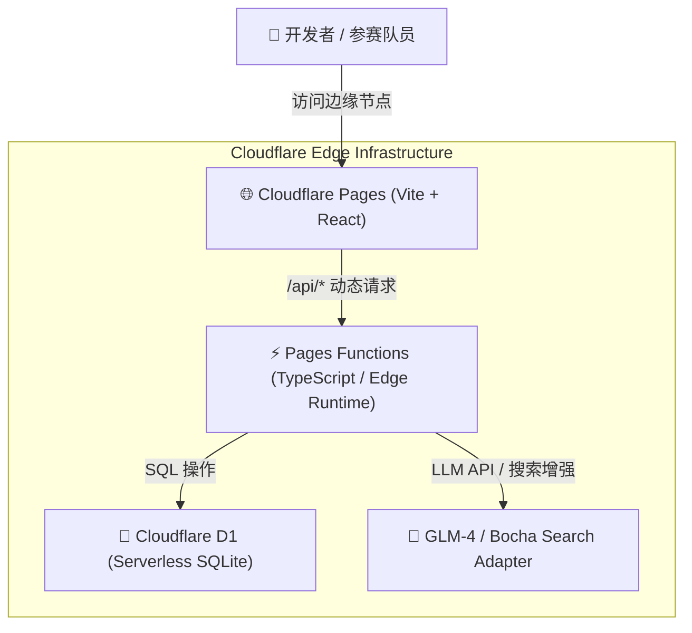

# 🚀 Competition Mission Control

<p align="center">
  <b>A Serverless Competition Planning & Milestone Dashboard</b><br>
  基于 Vite + React + Cloudflare Pages Functions + Cloudflare D1 的无服务器学科竞赛与项目里程碑中控面板
</p>

<p align="center">
  
  
  
  
  
  
  
</p>

---

## 📖 项目简介 (Overview)

**Competition Mission Control** 专为多线程学术竞赛备赛团队、科研项目组打造的里程碑与日程规划看板。

传统表格管理容易漏交材料、错过报名窗口或出现多端同步延迟。本项目利用 **Cloudflare 全球边缘网络（Pages + Functions + D1 分布式 SQLite）** 构建了极低延迟、零服务器运维成本的看板。系统支持日程事件流与月/周日历双重视图，并内嵌大模型 Copilot 提供竞赛检索与行动卡片建议。

---

## 🌟 核心特性 (Key Features)

- **📅 双重视图联动**：
  - **议程时间流 (Agenda Stream)**：按紧迫程度动态分组（Overdue / Today / This Week / This Month / Later），智能判定并收敛已错过窗口的竞赛条目。
  - **交互式日历 (Month & Week Views)**：月视图纵览全局关键节点，点击无缝下钻至 7 日精确全天事件流。
- **⚡ 纯边缘 Serverless 架构**：
  - 前端由 Cloudflare Pages 全球 CDN 加速交付。
  - 后端业务逻辑经由 Pages Functions 运行于 V8 隔离区，零冷启动延迟。
  - 数据由 Cloudflare D1 (Serverless SQLite) 持久化存储。
- **🤖 内置 AI 助理 (GLM-4 / Search)**：
  - 接入大模型自然语言交互，支持竞赛规则解析与日程建议。
  - AI 生成结构化“行动卡片”，经人工审核确认后单击直连写入 D1 数据库。
- **🧹 自动化 CSV 清洗与种子导入**：
  - 内置基于 Node.js 的清洗流水线，自动规范日期格式、去重合并并生成可复现的 SQL 迁移种子。

---

## 🏛️ 系统架构 (Architecture)



---

## 📦 项目结构 (Directory Structure)

```text
competition-mission-control/
├── db/                     # D1 数据库定义与种子 SQL
│   ├── schema.sql          # 竞赛里程碑与队伍表结构
│   └── seed_competitions.sql
├── functions/              # Cloudflare Pages Functions (API 路由)
│   └── api/                # /api/competitions CRUD 与 AI 对话端点
├── src/                    # 前端源码
│   ├── components/         # 议程列表、日历网格、侧边抽屉、AI 对话浮窗
│   ├── hooks/              # 数据请求与过滤 Hook
│   └── types/              # 竞赛数据模型与 TypeScript 接口定义
├── scripts/                # CSV 清洗与 SQL 种子生成脚本
└── wrangler.toml           # Cloudflare 绑定配置
```

---

## 🚀 快速开始 (Quickstart)

### 1. 安装依赖

```bash
git clone https://github.com/Evan-Joseph/competition-mission-control.git
cd competition-mission-control
npm install
```

### 2. 本地数据库初始化

利用 Cloudflare 官方 CLI `wrangler` 初始化本地 D1 数据库：

```bash
# 初始化表结构
npx wrangler d1 execute competitions-db --local --file=db/schema.sql

# 导入初始种子数据
npx wrangler d1 execute competitions-db --local --file=db/seed_competitions.sql
```

### 3. 本地边缘联调

```bash
npm run build
npx wrangler pages dev dist --d1 DB=competitions-db --local
```

打开终端输出的本地端口（通常为 `http://localhost:8788`），即可测试完整前后端与边缘数据库联动。

---

## ☁️ 部署到 Cloudflare Pages (Deploy to Cloudflare)

1. 在 [Cloudflare Dashboard](https://dash.cloudflare.com/) 中新建 D1 数据库：
   ```bash
   npx wrangler d1 create competitions-db
   ```
2. 绑定至 Cloudflare Pages 项目：
   - **Build Command**: `npm run build`
   - **Build output directory**: `dist`
   - **Functions directory**: `functions`
   - **D1 Database Binding**: 变量名设为 `DB`，绑定至 `competitions-db`。
3. 配置环境变量（可选 AI 特性）：
   - `GLM_API_KEY`: 智谱清言 API Key
   - `GLM_MODEL`: `glm-4.7-flash` (或兼容模型)

---

## 📄 开源许可证 (License)

本项目采用 [MIT License](LICENSE) 开源。
